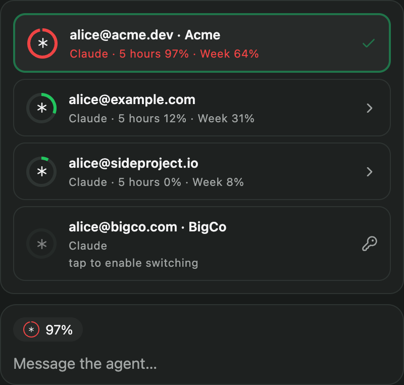
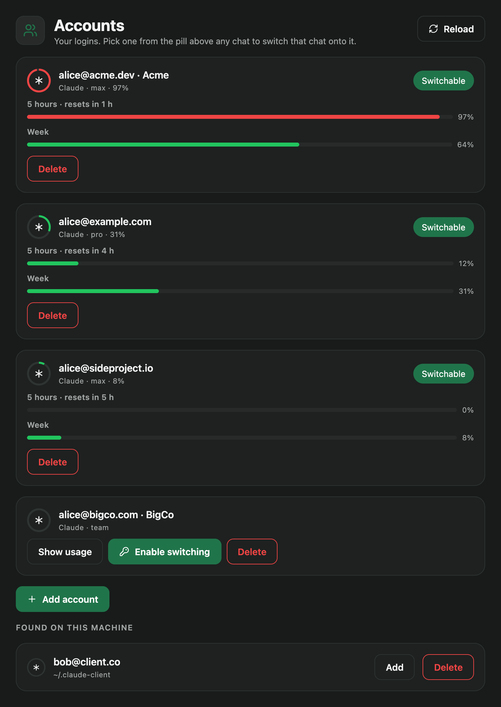

# Claude Accounts for Paseo

Run [Paseo](https://paseo.sh) chats on several Claude subscriptions, and move a chat to another
account while it is open. When one account hits its limit, pick another from the pill above the
composer: the session restarts on that account and the conversation carries on.

- **Composer pill.** Shows which account the chat runs on and how full its tighter usage window
  is. Press it to see every account's 5-hour and weekly allowance and switch the chat.
- **Accounts screen.** Every Claude login on the machine, grouped by subscription, with usage bars,
  login buttons and "Add account".
- **Per chat.** A switch moves one chat. Other chats, even in the same project, stay where they are.

<p>
  
  
</p>

## Requirements

- macOS (tokens and usage credentials live in the login Keychain)
- Paseo 0.11 or newer, with plugins enabled (Settings → Plugins)
- [Claude Code](https://docs.claude.com/en/docs/claude-code) installed

## Install

```sh
paseo plugin add git:kostilal/paseo-claude-accounts
```

Or paste `git:kostilal/paseo-claude-accounts` into **Settings → Plugins → Plugin source**.
**Accounts** then appears in the sidebar.

If `paseo` is not on your PATH, it is at `/Applications/Paseo.app/Contents/Resources/bin/paseo`.

## Getting started

1. **Add your accounts.** Open **Accounts**. Config directories that are already logged in show up
   under *Found on this machine*; press **Add** on each one you want. To add a subscription you
   have not used from this Mac yet, press **Add account**: a terminal opens `claude auth login`
   in a new `~/.claude-account-N` directory.
2. **Enable switching.** Press **Enable switching** on an account (or tap it in the pill). A
   terminal runs `claude setup-token`; approve in the browser with the account you want that row
   to bill. The token is checked and saved to the Keychain, and the terminal tells you when it is
   done.
3. **Switch.** In any Claude chat, press the pill and pick an account. If the agent is in the
   middle of a turn, the first press warns that the turn will be interrupted and the second press
   switches.

## How it works

**Accounts are config directories.** Claude Code keeps a login per `CLAUDE_CONFIG_DIR`. The plugin
finds:

- `~/.claude`, the default
- every `~/.claude-*`, `~/.claude_*` or `~/.claude.*` directory that contains a `.claude.json`
  (for example the directories you point `CLAUDE_CONFIG_DIR` at for work and personal use)
- `.claude-data` directories inside your Paseo projects, for setups that keep one config directory
  per project

Several directories signed in to the same login (same email and organisation) are shown as one
row, because they share one allowance.

**A switch injects a token, not a directory.** Each account gets a long-lived token from
`claude setup-token`, stored in the Keychain under service `paseo-claude-accounts`. Switching a
chat records the choice for that chat and restarts its session with `paseo agent reload`. When the
session reopens, the plugin's `agent.session_open` hook adds `CLAUDE_CODE_OAUTH_TOKEN` to its
environment. Nothing else changes: the session keeps whatever config directory it had, so the
transcript is where `--resume` looks for it, and the project's settings, permissions and MCP
servers stay in place. Chats you never switched are left alone.

If the restart fails, the choice is rolled back, so the pill never shows an account the chat is not
actually running on.

**Usage meters** come from the same endpoint Claude Code uses, called with each config directory's
own Claude Code credentials from the Keychain. Claude Code only refreshes those credentials while
it runs in that directory, so for a directory nobody uses they expire within hours; when that
happens the plugin runs `claude -p /usage` there (a local command: no model call, no hooks, no
saved session), which makes Claude Code refresh its own token, at most every 15 minutes per
directory. The screen and the pill try to read every logged-in account in the background, at
most every ten minutes. If macOS has not yet allowed Keychain access, a background read gives up
after three seconds and the row shows **Show usage** instead; a dialog may flash briefly. Press
**Show usage** once and choose "Always Allow" so later reads go through without asking.
The endpoint rate-limits aggressively; on a 429 the last reading is kept until the wait is over.

## Files and secrets

| What | Where |
|---|---|
| Accounts, per-chat choices, hidden directories | `~/.paseo-claude-accounts/accounts.json` |
| Switching tokens | Keychain, service `paseo-claude-accounts`, account = login email |
| `setup-token` transcripts while a token is being saved | `~/.paseo-claude-accounts/mints/`, mode 0700, deleted as soon as the token is read |

Tokens are never written to the state file, logged, or sent to the app. They are passed to
`security` on stdin, not on the command line. A switched session has its token in its process
environment, which on macOS is readable only by your user and root.

**Delete** on the Accounts screen only forgets an account: its directory, login and Keychain items
stay. **Show hidden** brings it back.

## Settings

In Paseo's settings, under **Accounts**:

- **Language**: English, Русский, Українська, or the same as Paseo
- **Pill above chats**: turn the composer pill off everywhere

## Limitations

- **macOS only.**
- **A switch restarts the session**, which ends a turn in progress.
- **Tokens from `setup-token` cannot read usage.** An account's meter comes from a config directory
  signed in to the same login. A token whose browser approval went to a different account than the
  directory is signed in as still works, but the meter shows the directory's account.
- **Revoked tokens are not detected in advance.** A chat switched to one fails on its next turn;
  run **Enable switching** again for that account.
- **API keys win.** If `ANTHROPIC_API_KEY`, `ANTHROPIC_AUTH_TOKEN`, `CLAUDE_CODE_USE_BEDROCK` or
  `CLAUDE_CODE_USE_VERTEX` is set in the environment Paseo starts Claude Code with, Claude Code
  ignores the account token. The plugin shows a warning when it finds one in the daemon's
  environment or in Paseo's Claude provider settings; a key exported by a custom launch command
  cannot be detected.
- **Codex** (`~/.codex`, `~/.codex-*`) is supported by pointing the chat at another `CODEX_HOME`.
  Codex has no readable usage endpoint, so its rows have no meter. Paseo has to be restarted after
  installing the Codex CLI before it offers Codex chats.

## Troubleshooting

**Every account shows "Not logged in".** The daemon could not run `claude`. The plugin looks in
`~/.local/bin`, `/opt/homebrew/bin`, `/usr/local/bin`, `~/.claude/local` and `~/.npm-global/bin`,
then PATH. A daemon started from the Dock does not get your shell's PATH.

**"Switching is not enabled for that account yet."** The account has no token. Press **Enable
switching**.

**A switch did nothing.** Check `paseo plugin logs claude-accounts`. The hook logs one line when it
leaves a session alone, for example when a Keychain dialog is waiting.

**Every plugin fails with `Module "@getpaseo/plugin/client" is not available`.** The app (often the
phone) is older than the daemon. Update it.

## Development

```sh
git clone https://github.com/kostilal/paseo-claude-accounts
cd paseo-claude-accounts
npm install
npm run typecheck
npm test
paseo plugin install "$(pwd)"       # once
paseo plugin reload claude-accounts # after each change
```

`index.server.ts` and `server/` run in the daemon, `index.client.tsx` and `client/` in the app,
`shared/` in both. Tests run with Node's built-in TypeScript support (Node 22.18 or newer).

## License

MIT
