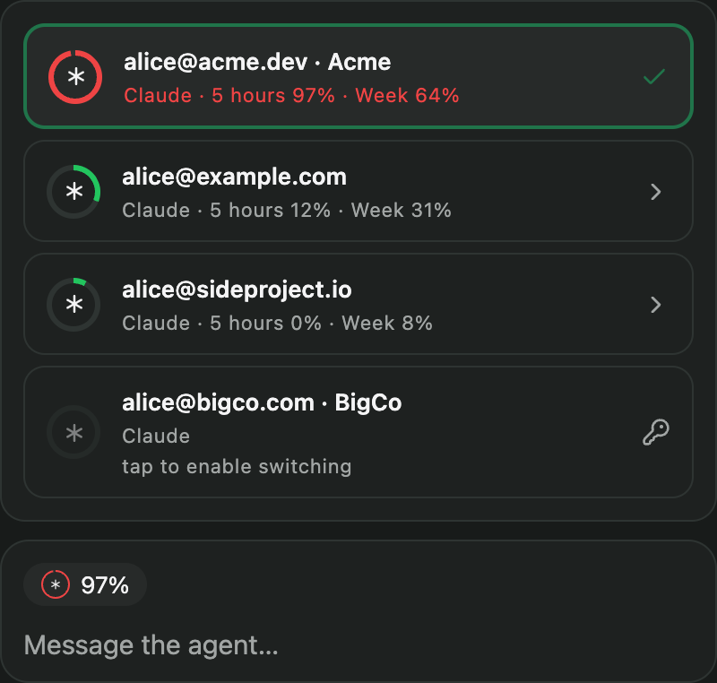
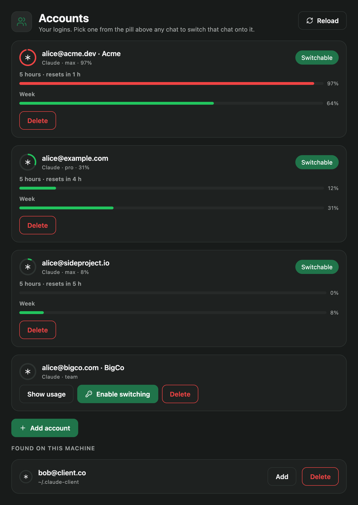

# Claude Accounts for Paseo

Run [Paseo](https://paseo.sh) chats on several Claude subscriptions, and move a chat to another
account while it is open. When one account hits its limit, pick another from the pill above the
composer: the session restarts on that account and the conversation carries on.

- **Composer pill.** Shows which account the chat runs on and the fuller of its two windows, the
  5 hours or the week: the time until that window resets, then how much of it is used. `3d 62%` is
  three days to go with 62% used, `2h 70%` two hours. Once a window is exhausted, `47min 100%` is
  the wait until the account can be used again. An account with no 5-hour window (Ultra) shows its
  week. Press it to see every account's allowance and switch the chat.
- **Accounts screen.** Every Claude login on the machine, grouped by subscription, with usage bars,
  login buttons and "Add account". It opens at once on the last data it was given, saved by the
  daemon, and updates in place while it measures; **Reload** re-measures every account.
- **Refresh in the popover.** In the pill's popover a small round button in the corner of an account
  measures that one, and beside it a small note says how long ago the account was last measured. A
  failure or the usage service's wait shows in the row. One above the list measures them all.
- **Forecast.** On the Accounts screen, tick the accounts to plan over: a chart of their combined
  reserve over time, every reset at its exact moment and the idle time marked, and hints both ways:
  when and by how much to slow down if an idle spell is coming, and which account to use first when
  its week would otherwise be lost at the reset. Reserve is a share of the ticked accounts' combined
  weekly capacity, never tokens: the provider reports percentages and reset times only.
- **Per chat.** A switch moves one chat. Other chats, even in the same project, stay where they are.
- **All chats at once.** "Move all chats here" on an account, pressed twice, moves every chat in
  every workspace onto it and makes it the default: chats opened later start on it too. Idle chats restart on it now, closed ones when they next open; a chat in the middle of
  a turn is left alone rather than cut off.
- **Default for new chats.** Settings → Plugins → Claude Accounts picks the account every new chat
  starts on, or **Auto**, which picks one by its allowance as each chat opens (see below);
  existing chats keep theirs. A new chat is not started when the default account cannot be used
  (removed, or its folder is gone), or when no default is set and the chat's own folder has no
  login: Paseo shows what to choose instead of an auth error.
- **Default in the header.** The **Users** button in a workspace's header picks the account
  every new chat opens on: **Auto**, or one account. The pill above a chat switches that chat.
- **On an account's card.** **New chats here** on the Accounts screen makes that account the
  default every new chat opens on.
- **One account per task** (Settings, off by default): Auto's first pick in a workspace holds for
  all its new chats, until the default changes. Off, every new chat is picked on its own.
- **On the new-workspace screen**, where there is no workspace header yet: **+** in the composer →
  **Claude account** starts the first chat on the account you pick (or on Auto's pick).

<p>
  
  
</p>

## Requirements

- macOS (logins live in the login Keychain)
- Paseo 0.11 or newer, with plugins enabled (Settings → Plugins)
- [Claude Code](https://docs.claude.com/en/docs/claude-code) installed

## Install

```sh
paseo plugin add git:kostilal/paseo-claude-accounts
```

Or paste `git:kostilal/paseo-claude-accounts` into **Settings → Plugins → Plugin source**.
**Accounts** then appears in the sidebar.

If `paseo` is not on your PATH, it is at `/Applications/Paseo.app/Contents/Resources/bin/paseo`.

## Getting started

1. **Add your accounts.** Open **Accounts**. Config directories that are already logged in show up
   under *Found on this machine*; press **Add** on each one you want. To add a subscription you
   have not used from this Mac yet, press **Add account**: a terminal opens `claude auth login`
   in a new `~/.claude-account-N` directory. Log in there and the account appears by itself.
2. **Switch.** In any Claude chat, press the pill and pick an account. If the agent is in the
   middle of a turn, the first press warns that the turn will be interrupted and the second press
   switches.

That is all: one login per account, the same login the account's usage is read from. There is no
second step and no separate switching key.

## How it works

**Accounts are config directories.** Claude Code keeps a login per `CLAUDE_CONFIG_DIR`. The plugin
finds:

- `~/.claude`, the default
- every `~/.claude-*`, `~/.claude_*` or `~/.claude.*` directory that contains a `.claude.json`
  (for example the directories you point `CLAUDE_CONFIG_DIR` at for work and personal use)
- `.claude-data` directories inside your Paseo projects, for setups that keep one config directory
  per project

Several directories signed in to the same login (same email and organisation) are shown as one
row, because they share one allowance. Who each directory is logged in as is asked of Anthropic
(`/api/oauth/profile`) with that directory's own login, not read from the account cached in its
`.claude.json`: Claude Code rewrites that cache to whatever login a chat in the folder runs on, so a
project whose chats were moved to another account would otherwise read as that account.

**A switch points the session at the account's login, not its directory.** Switching a chat records
the choice for that chat and restarts its session with `paseo agent reload`. When the session
reopens, the plugin's `agent.session_open` hook sets `CLAUDE_SECURESTORAGE_CONFIG_DIR` to the
account's directory, so Claude Code reads that account's login from the Keychain while the session
keeps its own config directory — the transcript is where `--resume` looks for it, and the project's
settings, permissions and MCP servers stay in place. The same login is what the account's usage is
read from, so the meter and the chat can never drift onto different accounts. Chats you never
switched are left alone.

If the restart fails, the choice is rolled back, so the pill never shows an account the chat is not
actually running on. Only that chat's choice is put back, and only if it is still the one written
for this switch, so a chat bound or moved meanwhile keeps its account.

**Which account a chat is really on.** The plugin does not trust a single record. It looks, in this
order, at the chat's running `claude` process (the `CLAUDE_SECURESTORAGE_CONFIG_DIR` it was started
with names the login it bills; a process started by the chat, such as Docker or a dev server, is
not the chat's session and is ignored), then at what the `agent.session_open` hook gave the session
the last time it opened (Claude Code only starts with the chat's next turn, so right after a restart
there is no process yet), then at the account on record for the chat. Where these disagree the
stronger one wins and the disagreement is named. A chat with none of them has no known account: the
default account is for new chats and is never put in its place.

**Which account a new chat opens on.** A new chat is placed once, before Claude Code starts, so
it never has to be switched (and restarted) on its first turn. In order:

1. `PASEO_CLAUDE_ACCOUNT` in the chat's environment: an account id (its folder name, `work` for
   `~/.claude-work`), e.g. `paseo run --env PASEO_CLAUDE_ACCOUNT=work …`. An id that cannot be
   used refuses the chat. Codex chats ignore it.
2. With **One account per task** on: the account Auto first picked in the workspace.
   `PASEO_CLAUDE_ACCOUNT=@auto` asks for an automatic pick. A **Claude account** attachment on a
   new workspace's first chat is turned into this variable.
3. The default: an account, or Auto.
4. The chat's own folder's login.

**Auto** reads each logged-in account's 5-hour and weekly allowance (the cached reading, or a new
one; an account that takes more than three seconds to check counts as unknown) and picks, among
accounts with less than 95% used in both windows, the one whose week resets soonest: what is left
of it is lost at the reset. Equal resets go to the emptier 5-hour window. Accounts whose allowance
could not be read come next, then accounts whose 5-hour window is 90% used or more (they would stop
the task within minutes), then full ones, the one that has room again soonest first, so a chat
still opens when every account is full. Chats started together in one workspace land on one
account. From 90% used in either window, the pill's popover warns; whether to move the chat is up
to you.

Paseo does not hand a plugin an agent's labels before its session starts, so a label cannot
choose the account; the environment variable can.

**Usage meters** come from the same endpoint Claude Code uses, called with each config directory's
own Claude Code credentials from the Keychain. Claude Code only refreshes those credentials while
it runs in that directory, so for a directory nobody uses they expire within hours; when that
happens the plugin runs `claude -p /usage` there (a local command: no model call, no hooks, no
saved session), which makes Claude Code refresh its own token, at most every 15 minutes per
directory. The screen and the pill try to read every logged-in account in the background, as
often as the **Auto-refresh** setting says (every ten minutes by default). If macOS has not yet allowed Keychain access, a background read gives up
after three seconds and the row shows **Show usage** instead; a dialog may flash briefly. Press
**Show usage** once and choose "Always Allow" so later reads go through without asking.
The endpoint rate-limits aggressively; on a 429 the last reading is kept until the wait is over.

**The forecast** works from what that endpoint reports, percentages and reset times for the 5-hour
window and the week, and from the plugin's own record of them, kept for eight days. No request is
made for it: every reading the screen and the pill take anyway is written down, which also means
history only grows while Paseo is open.

- *The pace* is the burn over the last day, idle hours included. With less than a day of readings
  it is blended with the average since the week began; with none it is that average alone.
- *Capacity.* There are no absolute units, so percentages of different accounts are weighed, never
  added as they stand. Accounts on one plan weigh the same. Otherwise a plan's multiple of Pro is
  used (Anthropic publishes those for the 5-hour window only, so for the week it is an assumption,
  and the screen says so) or a capacity set by hand. An account with neither stays out of the sum
  until it is given one.
- *The 5-hour window* is converted to the week by what the account's own readings show it costs.
  Until enough of them have moved together an assumed figure is used, shown as one, and tightened by
  what the current numbers rule out.
- *The run forward* goes from reset to reset at that pace, each at its exact time. Work goes to the
  account whose week resets soonest, and an account is out of the running while either of its
  windows is spent. A new 5-hour window starts with the next request after a reset.
- *What can still be spent* before a reset is what is left of the current 5-hour window and one
  whole window from each reset after it, up to what is left of the week. Only the windows limit it,
  not how fast anyone works.
- *Accuracy* is a level and a ± band around the pace, measured against how far each past day's pace
  was from the next day's once there are two such pairs, and a rule of thumb from the length of the
  history before that. Separate weekly limits per model are not counted. Everything assumed is
  listed under the chart.

## Files and secrets

| What | Where |
|---|---|
| Accounts, per-chat choices, hidden directories | `~/.paseo-claude-accounts/accounts.json` |
| The last overview the Accounts screen was given, with its emails (mode 0600) | `~/.paseo-claude-accounts/overview-snapshot.json` |
| The last eight days of usage readings, for the forecast: percentages and reset times (mode 0600) | `~/.paseo-claude-accounts/usage-history.json` |
| Each account's login | Claude Code's own Keychain item for that config directory; the plugin reads it, never writes it |

The plugin keeps no secret of its own: it stores no tokens, the state file holds only account
labels, directories and chat choices, and the saved overview holds what the Accounts screen shows. A switched session names the account's directory in its
process environment; Claude Code reads the login from the Keychain itself.

**Delete** on the Accounts screen only forgets an account: its directory and login stay.
**Show hidden** brings it back.

## Settings

In Paseo's settings, under **Accounts**:

- **Language**: English, Русский, Українська, or the same as Paseo
- **Pill above chats**: turn the composer pill off everywhere
- **Default account for new chats**: an account, **Auto**, or not set
- **How Auto picks**: the week that resets soonest first, or the most room left first
- **One account per task**: off by default
- **Auto-refresh**: how often accounts are measured again while Paseo is open, from 5 to 60 minutes;
  10 by default

## From ChatGPT

With [Paseo God Mode](https://github.com/devXpro/paseo-god-mode-plugin) 0.10 or newer, ChatGPT can
read the accounts and their usage, have usage measured now, tell which account any chat really runs
on, and move one chat or every chat to an account. The plugin describes this itself through
`meta.describe` (`paseo.capabilities/1`); God Mode needs no change.

| Operation | What it does |
|---|---|
| `accounts`, `accounts_fresh` | Every login with its 5-hour and weekly allowance, from the cache or measured now. |
| `chat_account`, `chat_account_fresh` | For one chat, by its full id: the account it runs on (id, label, email, organisation, plan), what that rests on (`basis`: process, session, binding or none) and where the sources disagree (`note`), and that account's 5-hour and weekly windows: percent used and left, when each resets, and how old the numbers are (`usageAgeSeconds`, `usageStale`, `usageHeldSeconds` while the usage endpoint rate-limits). |
| `chat_move_check` | A dry run of a move that changes nothing: the chat, the account it is on, the account it would move to, and why it cannot (`unknown-chat`, `archived`, `provider-mismatch`, `unsupported-provider`, `unknown-account`, `not-logged-in`, `missing-directory`, `first-turn`). |
| `switch_chat` | Moves one chat. Confirmed first against the dry run, and reported with `from`, `to`, `interrupted` and `applied` (`verified`, `next-open`, `pending`, `unverified`). |
| `switch_all` | Moves every chat to an account and makes it the default. |

Moves are read back to you before they run, naming the chat from Paseo's own data and the accounts
from the plugin's, and a refused switch is reported as not done. Adding, deleting and logging in are
not offered.

## Limitations

- **macOS only.** A session reads its login from the Keychain by directory, which the
  `CLAUDE_SECURESTORAGE_CONFIG_DIR` variable redirects; the switch is built on that.
- **A switch restarts the session**, which ends a turn in progress. It is refused until the chat's
  first turn is saved: Claude Code writes the transcript a few seconds into that turn, and a
  restart before then leaves Paseo resuming a session that does not exist ("No conversation
  found"). Only chats created in the last ten minutes are checked, so a wrong refusal lasts ten
  minutes at most; a chat left empty for longer before its first message is not protected.
  "Move all chats here" skips such chats.
- **One Claude chat moves at a time; a single Codex chat does not.** A Codex session keeps its
  history in the folder it runs in, so pointing one chat at another account's folder would leave the
  conversation behind. An archived chat is not moved either, since a restart would bring it back from
  the archive. A closed chat only gets its new account written down and takes it when it next opens
  (`applied: next-open`).
- **A switch waits for the restart for 25 seconds.** Paseo gives a plugin call 30. A restart still
  running then is answered `pending` and its choice kept; `chat_account` shows where the chat
  ended up. A switch also checks, from the hook's record, that the new session was given the
  account; one that was not is reported `not-applied` and its choice is put back.
- **A switched chat shares the account's rotating login.** It is the same login the directory uses,
  refreshed in place, so chats never fight over a copied token — but logging that account out (or
  renaming its folder) logs out every chat on it until it logs in again.
- **API keys win.** If `ANTHROPIC_API_KEY`, `ANTHROPIC_AUTH_TOKEN`, `CLAUDE_CODE_USE_BEDROCK` or
  `CLAUDE_CODE_USE_VERTEX` is set in the environment Paseo starts Claude Code with, Claude Code
  ignores the account login. The plugin shows a warning when it finds one in the daemon's
  environment or in Paseo's Claude provider settings; a key exported by a custom launch command
  cannot be detected.
- **Codex** (`~/.codex`, `~/.codex-*`) is supported by pointing the chat at another `CODEX_HOME`.
  Codex has no readable usage endpoint, so its rows have no meter. Paseo has to be restarted after
  installing the Codex CLI before it offers Codex chats.

## Troubleshooting

**Every account shows "Not logged in".** The daemon could not run `claude`. The plugin looks in
`~/.local/bin`, `/opt/homebrew/bin`, `/usr/local/bin`, `~/.claude/local` and `~/.npm-global/bin`,
then PATH. A daemon started from the Dock does not get your shell's PATH.

**A switch did nothing.** Check `paseo plugin logs claude-accounts`. The hook logs one line when it
leaves a session alone, for example when the account's directory is gone.

**Upgrading from 0.1.x.** The old per-account switching keys are no longer used; the plugin deletes
them from the Keychain and drops them from the state file on its first run. Each account now runs on
its directory's own login, so no action is needed — if an account was only ever switchable through a
key and its directory was never logged in, log in to it once on the Accounts screen.

**Every plugin fails with `Module "@getpaseo/plugin/client" is not available`.** The app (often the
phone) is older than the daemon. Update it.

## Development

```sh
git clone https://github.com/kostilal/paseo-claude-accounts
cd paseo-claude-accounts
npm install
npm run typecheck
npm test
paseo plugin install "$(pwd)"       # once
paseo plugin reload claude-accounts # after each change
```

`index.server.ts` and `server/` run in the daemon, `index.client.tsx` and `client/` in the app,
`shared/` in both. Tests run with Node's built-in TypeScript support (Node 22.18 or newer).

## License

MIT
